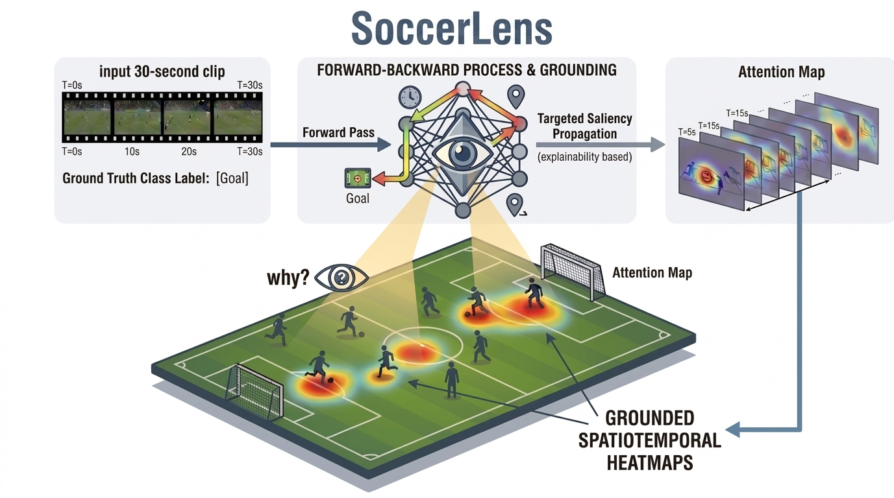

# SoccerLens: code and dataset



SoccerLens is a benchmark for whether soccer video models ground their event predictions in
the right visual evidence. This folder contains **the SoccerLens dataset** and **the code** to
compute attribution maps for six models and score them against the annotations.

---

## Where is the dataset?

> **The dataset is in [`data/`](data/). Everything in `data/` is the dataset; nothing outside
> it is.** Full documentation of the files and fields: [`data/README.md`](data/README.md).

```
data/
├── annotations/                         <- cue bounding boxes, COCO format
│   ├── annotations-coco.json            200 clips, human annotations   (gold)
│   ├── annotations-coco-extra800.json   800 clips, Gemini annotations  (silver)
│   └── annotations-coco-merged.json     all 1,000 clips
└── clips/                               <- the list of clips (video path, event class, commentary)
    ├── selected_videos_for_annotations.json         200 clips
    ├── selected_videos_for_annotations_800.json     800 clips
    └── selected_videos_for_annotations_merged.json  1,000 clips
```

| Split | Clips | Annotation file | Clip list |
|---|---|---|---|
| Human (gold) | 200 | `data/annotations/annotations-coco.json` | `data/clips/selected_videos_for_annotations.json` |
| Gemini (silver) | 800 | `data/annotations/annotations-coco-extra800.json` | `data/clips/selected_videos_for_annotations_800.json` |
| **All** | **1,000** | `data/annotations/annotations-coco-merged.json` | `data/clips/selected_videos_for_annotations_merged.json` |

Each clip has per-second boxes for three cue tiers: `small label` = **Primary** (P),
`large label` = **Secondary** (S), `visual cue` = **Common** (C).

**The videos themselves are not included** (SoccerNet license). The clips are 30 s cuts of
the SoccerNet 720p broadcasts; [`data/README.md`](data/README.md#the-video-clips-are-not-included)
explains how to obtain and cut them, and where to point the code at them.

---

## Attribution explorer (demo)

> **Open [`demo/site/index.html`](demo/site/index.html) in a browser** (double-click it). It
> runs offline from the file, with no server and no installation.

The explorer shows the attribution maps of **MatchVision** (Chefer-T), **SigLIP** (Chefer)
and **SoccerMaster** (Chefer-T) on **51 human-annotated clips**: 4 per event class (3 for Red
Card), including every clip shown in the paper figures (marked with the figure number).

For each clip you see, frame by frame:

- the input frame with the annotated cue boxes (Primary, Secondary, Common),
- each model's attribution map over the frame, with its prediction and grounding metrics,
- a timeline of each model's per-frame temporal relevance against the annotated cue windows.

**Controls**

| Action | How |
|---|---|
| Choose a clip | click it in the clip list (the URL updates, so a clip can be linked directly) |
| Step through frames | <kbd>&larr;</kbd> / <kbd>&rarr;</kbd>, or click the timeline or the film strip |
| Play / pause | <kbd>Space</kbd> or the play button (speed 1x / 2x / 4x) |
| Enlarge a panel | click it, or press <kbd>1</kbd>-<kbd>4</kbd>; <kbd>Esc</kbd> returns to the grid |
| Change the cue tier scored | P / P+S / P+S+C buttons |

The page also has a short "How to read this page" box.

**Files.** `demo/site/` is the built explorer (`index.html`, `data.js` with the maps and
metrics, and one frame sheet per clip in `frames/`). It is included in the supplementary
material; in the git repository it is not tracked, so build it as below.

**Rebuilding it.** `demo/template.html` is the page itself (layout, style and code, no data).
`demo/build_demo.py` fills it with data: it samples the clips' frames, reads the saved
saliency maps of the three models, and writes `demo/site/`:

```bash
python demo/build_demo.py --raw <folder with the clips> --outputs <root of the inference outputs> \
    [--per_class 4] [--out demo/site]
```

`--outputs` must contain `output_chefer_{matchvision_temporal,siglip,soccermaster_temporal}/saliency/`,
i.e. inference runs with `--saliency_save_dir`. Boxes are read from
`data/annotations/annotations-coco.json`.

---

## Repository structure

```
├── data/                     THE DATASET (annotations + clip lists), see data/README.md
│
├── inference/                attribution maps and evaluation
│   ├── chefer_siglip.py, chefer_matchvision[_temporal].py, chefer_soccermaster[_temporal].py
│   │                         Chefer / Chefer-T maps for SigLIP, MatchVision, SoccerMaster
│   ├── chefer_baselines.py   Chefer / Chefer-T maps for CLIP, PE-AV, VideoPrism
│   ├── gradcam_inference.py  Grad-CAM maps
│   ├── grounding_metrics.py  all grounding metrics (Energy, Pointing, S-IoU, S-AUROC/AUPRC, T-IoU, T-AUROC/AUPRC)
│   ├── evaluate_grounding.py scores saved maps against data/annotations (no GPU needed)
│   ├── perturbation_faithfulness.py   SaCo / MoRF / LeRF faithfulness test
│   ├── frame_selection.py    relevance-guided frame selection
│   ├── convergence_analysis.py        bootstrap CIs and per-class tables
│   └── ...                   shared utilities, visualization
├── model/                    model wrappers (SigLIP, MatchVision, SoccerMaster)
├── dataset/                  video loading
├── config/                   model / data configs (set the video folder here: video_base)
├── colab/                    end-to-end drivers (run_table1.sh, run_perturbation.sh, run_frame_selection.sh)
├── run_*.sh                  SLURM job scripts, one per model x method
├── silver_annotation/        how the 800 Gemini annotations were produced
├── sample_annotation_clips.py  how the 800 extra clips were sampled
├── build_baseline_table.py   LaTeX table from evaluation outputs
├── demo/                     attribution explorer, see "Attribution explorer (demo)" above
│   ├── site/index.html       the built explorer: open in a browser
│   ├── template.html         the page source (no data)
│   └── build_demo.py         builds site/ from saved saliency maps
├── extracted_frames/, paper_figure_*.png, assets/   figure material
└── environment.txt, requirements_environment.txt    dependencies
```

---

## Setup

```bash
conda create -n soccerexplain python=3.10
conda activate soccerexplain
pip install -r requirements_environment.txt
```

**Pre-trained checkpoints**

```bash
# MatchVision
wget https://huggingface.co/Homie0609/UniSoccer/resolve/main/pretrained_classification.pth
# SoccerMaster
git clone https://huggingface.co/xleprime/SoccerMaster
```

- Place the MatchVision `.pth` file under `model/MatchVision/pretrained_models/` (or pass `--checkpoint_path`).
- Place the cloned SoccerMaster directory under `model/SoccerMaster/pretrained_models/SoccerMaster/`.
- SigLIP, CLIP, PE-AV and VideoPrism weights are downloaded automatically from HuggingFace.

**Paths.** The configs in `config/` assume the repository is at `/content/SoccerExplainability`
(Colab) and the clips at `/content/drive/MyDrive/SoccerLens/`. Elsewhere, edit `video_base` and
the clip-list path in `config/pretrain_classification.py`, or set `SOCCER_DIR` / `CLIP_ROOT`
for the `colab/*.sh` drivers.

---

## Reproducing the grounding results (all six models)

`colab/run_table1.sh` runs the whole pipeline: SigLIP, MatchVision and SoccerMaster through
their scripts, then CLIP, PE-AV and VideoPrism through `inference/chefer_baselines.py` (which
needs transformers 5.22.2 and timm 1.0.31, so it runs as a second stage), and finally scores
everything with `inference/evaluate_grounding.py`. On Colab, with this folder copied to
`/content/SoccerExplainability` and the clips on Drive:

```python
from google.colab import drive
drive.mount('/content/drive')
!bash /content/SoccerExplainability/colab/run_table1.sh
```

All metrics come from one module, `inference/grounding_metrics.py`. It reads only the saved
`saliency/*.npz` maps and an annotation file from `data/annotations/`, so any finished run can
be rescored without a GPU:

```bash
python inference/evaluate_grounding.py --coco_json data/annotations/annotations-coco.json \
    --run SigLIP=<dir> --run CLIP=<dir> --run PE-AV=<dir> \
    --run VideoPrism=<dir> --run MatchVision=<dir> --run SoccerMaster=<dir> \
    --resolution frame native --out_dir <out>
```

- `frame` upsamples every map bilinearly to a 720x1280 canvas before scoring.
- `native` scores each model on its own token grid.

Pass `--coco_json data/annotations/annotations-coco-merged.json` to score on all 1,000 clips,
or `annotations-coco-extra800.json` for the 800 Gemini-annotated clips only.

### Running inference on the 800 extra clips

They have no human boxes, so inference uses a placeholder COCO file that only lists their
frames, and scoring uses the Gemini annotations:

```bash
python colab/make_placeholder_coco.py \
    data/clips/selected_videos_for_annotations_800.json /content/placeholder_800-coco.json
CONFIG=config/pretrain_classification_800.py \
COCO_JSON=/content/placeholder_800-coco.json \
EVAL_COCO_JSON=data/annotations/annotations-coco-extra800.json \
EXPECTED_CLIPS=800 REFERENCE="" \
bash colab/run_table1.sh
```

`REFERENCE=""` skips the comparison with the reference values in
`inference/table1_reference.json`, which are for the 200 human-annotated clips. SoccerMaster at
512 px with 30 frames needs about 96 GB of GPU memory.

### Single model with SLURM

Each model x method has a script in the root (`run_chefer_*.sh`, `run_gradcam*.sh`). Edit the
path variables at the top (`SOCCER_DIR`, `CHECKPOINT_DIR`, `HF_HOME`, `--account`) and submit,
e.g. `sbatch run_chefer_matchvision_temporal.sh`. Each writes attribution visualizations and an
`*_eval_results.json` to its `output_*/` directory; `python build_baseline_table.py` collects
them into a LaTeX table.

---

## Convergence analysis and per-class tables

Pass `--saliency_save_dir <dir>` to any inference script to save per-clip maps and scores, then

```bash
python inference/convergence_analysis.py --saliency_dir <dir>
```

computes bootstrap means with 95% confidence intervals, the clip count at which each metric
stabilizes, and a per-class metrics table, under `<dir>/analysis/`.

---

## Perturbation faithfulness

`inference/perturbation_faithfulness.py` tests the maps against the model: it re-loads a clip,
masks model patches ranked by the saved map and re-runs the forward pass. Tokens are split into
K equal salience groups (default K=10) and three perturbation families are scored with the
softmax probability of the explained class:

- **Independent groups** (one bin at a time) -> **SaCo** (Wu et al., CVPR 2024), in [-1, 1];
  a random map scores 0.
- **MoRF** (cumulative, most relevant first) -> deletion curve, AOPC, flip rate.
- **LeRF** (cumulative, least relevant first) -> control curve; a faithful map has a large
  LeRF - MoRF gap.

Every clip is also run with a random map under the same protocol, to subtract the effect of
masking alone. Masked patches are filled with the per-clip channel mean (`--fill mean`).

```bash
python inference/perturbation_faithfulness.py --model soccermaster \
    --config_path config/pretrain_classification.py \
    --saliency_dir <run>/soccermaster/saliency --out_dir <run>/soccermaster/perturbation \
    --checkpoint_dir <SoccerMaster ckpt dir> --groups 10 --ranking clip --fill mean

python inference/perturbation_faithfulness.py --out_dir <run>/perturbation \
    --summarize_runs SigLIP=<run>/siglip/perturbation SoccerMaster=<run>/soccermaster/perturbation
```

`RUN_DIR=<run> bash colab/run_perturbation.sh` runs all six models of a finished run.

---

## Relevance-guided frame selection

`inference/frame_selection.py` keeps only k of the 30 frames (k = 1, 3, 5, 10) and re-classifies
the clip, comparing the k most relevant frames by the model's own map with uniform, random and
least-relevant frames, and optionally with frames chosen by another model's map
(`--rank_saliency_dir`). Unselected frames are mean-filled (`--mode mask`) or removed
(`--mode drop`, SigLIP and CLIP only). The primary table uses correctly classified clips, since
the saved maps explain the ground-truth class.

```bash
python inference/frame_selection.py --model matchvision --config_path config/pretrain_classification.py \
    --saliency_dir <run>/matchvision/saliency --out_dir <run>/matchvision/frame_selection \
    --checkpoint_path <MatchVision ckpt> --mode mask
```

`RUN_DIR=<run> bash colab/run_frame_selection.sh` runs all six models.

---

## References

- Chefer, H., Gur, S., & Wolf, L. (2021). *Generic Attention-model Explainability for Interpreting Bi-Modal and Encoder-Decoder Transformers.* ICCV 2021. [[arXiv]](https://arxiv.org/abs/2103.15679)
- Wu, J., Kang, W., Tang, H., Hong, Y., & Yan, Y. (2024). *On the Faithfulness of Vision Transformer Explanations.* CVPR 2024. [[arXiv]](https://arxiv.org/abs/2404.01415)
- SoccerNet: [[soccer-net.org]](https://www.soccer-net.org/)
