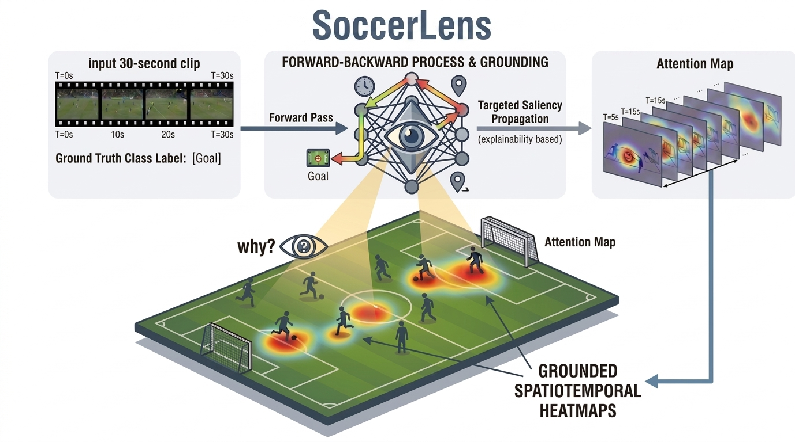

# SoccerLens



Explainability benchmark for soccer video event-classification models, evaluating **Chefer** (transformer attention-based) attribution methods on three vision backbones: SigLIP, MatchVision, and SoccerMaster.

---

## Overview

This repo benchmarks how well saliency maps generated by the Chefer attribution method align with ground-truth spatial bounding boxes and temporal event windows in soccer broadcast clips.

**Models evaluated**

| Model | Backbone | Input |
|-------|----------|-------|
| SigLIP | SigLIP-base-patch16-224 | Frames (spatial only) |
| MatchVision | VisionTimesformer (SigLIP-base + temporal) | 30-frame clips |
| SoccerMaster | SigLIP2-large-patch16-512 + temporal gates (layer ≥16) | 30-frame clips |

**Attribution methods**

- **Chefer (Spatial)** — attention × gradient relevance propagation across all spatial layers ([Chefer et al., ICCV 2021](https://arxiv.org/abs/2103.15679))
- **Chefer (Temporal)** — same propagation extended to temporal attention layers (MatchVision / SoccerMaster only)

**Evaluation metrics**

- **Energy** — fraction of saliency mass inside ground-truth bounding boxes
- **Pointing** — whether the peak activation falls inside a bounding box
- **S-IoU** — IoU between the thresholded saliency map and bounding-box mask
- **S-AUC** — threshold-free spatial grounding: pixel-level ROC-AUC of the continuous saliency map against the bounding-box mask
- **T-IoU** — IoU between predicted and ground-truth active frame sets
- **T-IoU (sweep)** — T-IoU averaged over a sweep of salient-frame thresholds (0.1–0.9), removing dependence on a single fixed cutoff
- **T-AUC / T-AP** — threshold-free temporal grounding: ROC-AUC and Average Precision of the per-frame saliency signal against the active-frame ground truth

Annotations are stored in COCO format (`annotations-coco.json`), with per-second bounding boxes annotated over 13 SoccerNet-v2 event classes.

---

## Repository Structure

```
├── annotations-coco.json          # Ground-truth bounding boxes (COCO format)
├── build_baseline_table.py        # Build LaTeX results table from eval JSONs
├── requirements_environment.txt   # Pinned dependencies
├── run_*.sh                       # SLURM job scripts (one per model × method)
├── config/                        # Model config files
├── dataset/                       # Video loading utilities
├── inference/
│   ├── chefer_matchvision.py      # Chefer spatial — MatchVision
│   ├── chefer_matchvision_temporal.py
│   ├── chefer_siglip.py           # Chefer spatial — SigLIP
│   ├── chefer_soccermaster.py     # Chefer spatial — SoccerMaster
│   ├── chefer_soccermaster_temporal.py
│   ├── coco_attribution_eval.py   # Metric computation (Energy / Pointing / IoU)
│   ├── inference_utils.py         # Shared utilities and attention wrapping
│   └── visualization_video.py
└── model/
    ├── SigLIP_classifier.py
    ├── MatchVision/
    └── SoccerMaster/
```

---

## Setup

```bash
conda create -n soccerexplain python=3.10
conda activate soccerexplain
pip install -r requirements_environment.txt
```

**Pre-trained checkpoints**

```bash
# MatchVision
wget https://huggingface.co/Homie0609/UniSoccer/resolve/main/pretrained_classification.pth

# SoccerMaster
git clone https://huggingface.co/xleprime/SoccerMaster
```

- Place the MatchVision `.pth` file under `model/MatchVision/pretrained_models/` (or pass `--checkpoint_path`)
- Place the cloned SoccerMaster directory under `model/SoccerMaster/pretrained_models/SoccerMaster/`
- SigLIP weights are downloaded automatically from HuggingFace (`google/siglip-base-patch16-224` / `google/siglip2-large-patch16-512`)

---

## Running Inference

Each combination of model × method has a corresponding SLURM script. Edit the path variables at the top of each script (`SOCCER_DIR`, `CHECKPOINT_DIR`, `HF_HOME`, `--account`), then submit:

```bash
# Examples
sbatch run_chefer_matchvision.sh
sbatch run_chefer_matchvision_temporal.sh
sbatch run_chefer_soccermaster.sh
sbatch run_chefer_soccermaster_temporal.sh
sbatch run_chefer_siglip.sh
```

Each script writes per-video attribution visualizations and an `*_eval_results.json` to its `output_*/` directory.

---

## Building the Results Table

After all jobs finish, generate the LaTeX table:

```bash
python build_baseline_table.py
```

The script reads `output_*/` directories and prints a table of Energy / Pointing / S-IoU / S-AUC / T-IoU / T-IoU (sweep) / T-AUC / T-AP across all three label-set tiers (P, P+S, P+S+C).

---

## Reproducing Table 1 (all six models)

`colab/run_table1.sh` runs the whole Table 1 pipeline on Colab: SigLIP,
MatchVision and SoccerMaster through their existing scripts, then CLIP, PE-AV
and VideoPrism through `inference/chefer_baselines.py`. That script needs
transformers 5.22.2 and timm 1.0.31, so it runs as a second stage after the
repo environment. It then scores everything with
`inference/evaluate_grounding.py`:

```python
from google.colab import drive
drive.mount('/content/drive')
!git clone -b table1-eval https://github.com/IsmaelElsharkawi/SoccerExplainability.git /content/SoccerExplainability
!bash /content/SoccerExplainability/colab/run_table1.sh
```

All Table 1 metrics (Energy, Pointing, S-AUROC, S-AUPRC, T-IoU, plus S-IoU)
come from one module, `inference/grounding_metrics.py`. It reads only the saved
`saliency/*.npz` maps and `annotations-coco.json`, so any finished run can be
rescored without a GPU:

```bash
python inference/evaluate_grounding.py --coco_json annotations-coco.json \
    --run SigLIP=<dir> --run CLIP=<dir> --run PE-AV=<dir> \
    --run VideoPrism=<dir> --run MatchVision=<dir> --run SoccerMaster=<dir> \
    --resolution frame native --out_dir <out>
```

The evaluator scores at two resolutions:

- `frame` upsamples every map bilinearly to a 720×1280 canvas before scoring
  (paper Sec. 4.2).
- `native` scores each model on its own token grid, as the inference scripts'
  built-in evaluator does. `validation_native.md` compares every cell against
  the paper values in `inference/table1_reference.json`.

---

## Convergence Analysis & Per-Class Tables

Pass `--saliency_save_dir <dir>` to any inference script to persist per-clip
saliency maps and scores (one `.npz` + `.json` per clip). Then run:

```bash
python inference/convergence_analysis.py --saliency_dir <dir>
```

This performs a bootstrap convergence analysis (mean + 95% confidence interval
per metric, and the clip count at which each metric stabilizes) and writes a
per-class metrics table grouped by soccer event, under `<dir>/analysis/`.

---

## Perturbation Faithfulness (does the model use what the map highlights?)

Grounding metrics compare maps against human boxes. `inference/perturbation_faithfulness.py`
tests the maps against the model instead: it reads the saved `saliency/*.npz`
of a run, re-loads the same frames, masks model patches ranked by the map and
re-runs the forward pass. Tokens are split into K equal salience groups
(default K=10, i.e. 10% bins) and three perturbation families are scored with
the explained class' softmax probability:

- **Independent groups** (one bin at a time) → **SaCo**, the Salience-guided
  Faithfulness Coefficient of Wu et al. (CVPR 2024): a Kendall-style
  coefficient in [-1, 1] of whether the probability drops are ordered like the
  salience, weighted by the salience differences. A random map scores 0.
- **MoRF** (cumulative, most relevant first) → deletion curve, AOPC (mean
  probability drop), top-1 flip rate per masked fraction, and the smallest
  masked fraction at which the prediction flips.
- **LeRF** (cumulative, least relevant first) → the control curve; a faithful
  map has a large LeRF − MoRF area gap.

Every clip is also run with a uniformly random map under the same protocol
so that the masking artifact alone (an off-manifold input) can be subtracted.
Masked patches are filled with the per-clip channel mean (`--fill mean`) or
zero. Results are reported for all clips and for correctly classified clips,
with bootstrap CIs.

```bash
# one model (its saliency dir comes from a Table 1 run)
python inference/perturbation_faithfulness.py --model soccermaster \
    --config_path config/pretrain_classification.py \
    --saliency_dir <run>/soccermaster/saliency --out_dir <run>/soccermaster/perturbation \
    --checkpoint_dir <SoccerMaster ckpt dir> --groups 10 --ranking clip --fill mean

# combine finished runs into one table
python inference/perturbation_faithfulness.py --out_dir <run>/perturbation \
    --summarize_runs SigLIP=<run>/siglip/perturbation SoccerMaster=<run>/soccermaster/perturbation
```

`colab/run_perturbation.sh` runs all six models of a Table 1 run directory
(`RUN_DIR=... bash colab/run_perturbation.sh`). Per-clip results are written
to `<out_dir>/clips/` and the run resumes from them.

---

## Relevance-Guided Frame Selection (a practical use of the maps)

If the maps are faithful, they tell us *which frames* a decision rests on
(per-frame relevance = the saliency volume summed over a frame, i.e. the
`frame_scores` of each saved npz). `inference/frame_selection.py` turns this
into a frame-budget experiment: for k = 1, 3, 5, 10 of the 30 frames
(`--budgets`) it keeps only k frames and re-classifies the clip, comparing

- **relevance**: the k most relevant frames by the model's own map,
- **uniform**: k evenly spaced frames (what a k-frame sampler would take),
- **random**: k random frames,
- **least**: the k least relevant frames (negative control),
- **transfer** (optional, `--rank_saliency_dir`): the top-k frames by *another*
  model's map, i.e. a cheap model selecting frames for an expensive one.

The readout is agreement with the full-clip prediction (and accuracy) per
budget, the smallest budget reaching 90% agreement, and the per-clip minimal
sufficient number of frames. Unselected frames are either mean-filled
(`--mode mask`, every model, same operation as the perturbation test) or
really removed (`--mode drop`, the compute saving; SigLIP and CLIP only,
since the other models have a fixed-length temporal embedding).

The saved maps explain the ground-truth class, so frame selection by the map
leaks the label on misclassified clips. The primary table is therefore the
correctly classified subset (explained class == predicted class); the
uniform and random rows are leakage-free everywhere.

```bash
python inference/frame_selection.py --model matchvision --config_path config/pretrain_classification.py\
    --saliency_dir <run>/matchvision/saliency --out_dir <run>/matchvision/frame_selection\
    --checkpoint_path <MatchVision ckpt> --mode mask

# SoccerMaster with frames chosen by MatchVision's maps (transfer condition)
python inference/frame_selection.py --model soccermaster ...\
    --rank_saliency_dir <run>/matchvision/saliency --rank_label MatchVision

python inference/frame_selection.py --out_dir <run>/frame_selection\
    --summarize_runs MatchVision=<run>/matchvision/frame_selection SoccerMaster=<run>/soccermaster/frame_selection
```

`colab/run_frame_selection.sh` runs all six models of a Table 1 run directory
(`RUN_DIR=... [MODE=mask|drop] [RANK_FROM=matchvision] bash colab/run_frame_selection.sh`)
and writes `<run>/frame_selection/summary_all.md` and `curves_all.png`.

---

## References

- Chefer, H., Gur, S., & Wolf, L. (2021). *Generic Attention-model Explainability for Interpreting Bi-Modal and Encoder-Decoder Transformers.* ICCV 2021. [[arXiv]](https://arxiv.org/abs/2103.15679)
- Wu, J., Kang, W., Tang, H., Hong, Y., & Yan, Y. (2024). *On the Faithfulness of Vision Transformer Explanations.* CVPR 2024. [[arXiv]](https://arxiv.org/abs/2404.01415)
- SoccerNet-v2 dataset and event taxonomy: [[SoccerNet]](https://www.soccer-net.org/)
